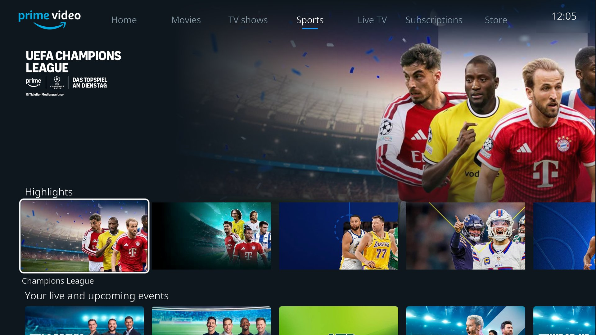
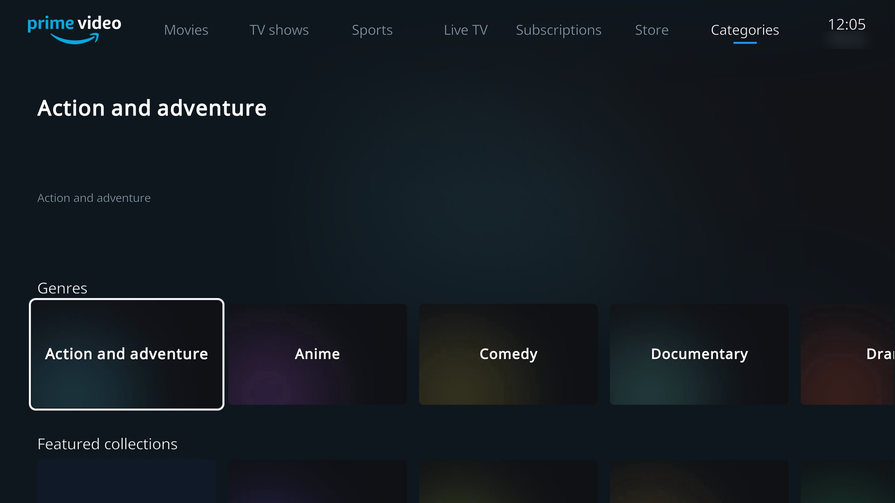
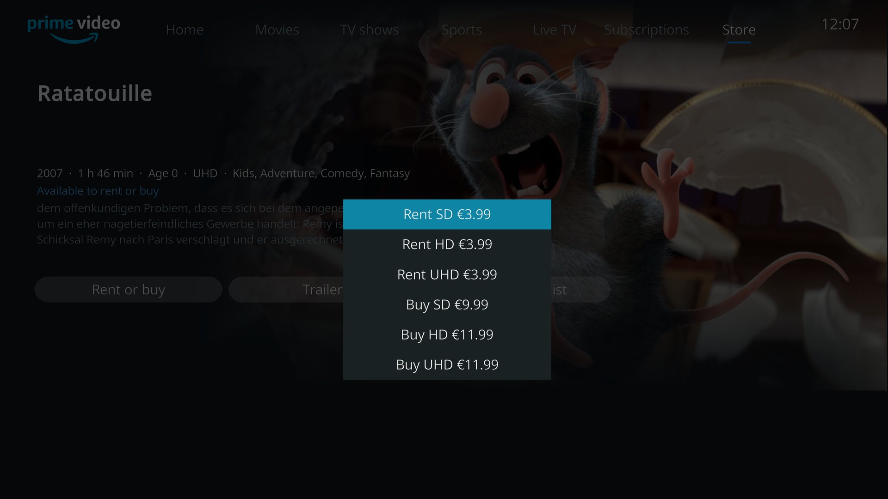

# Amazon VOD for Kodi – TV interface fork

**Deutsch:** Dieser Fork des [Amazon-VOD-Addons](https://github.com/Sandmann79/xbmc) von Sandmann79 bringt
eine Oberfläche wie die Prime-Video-App auf Fire TV, gemacht für die Fernbedienung:

- Tab-Leiste aus der Navigation von Prime Video (Startseite, Filme, Serien, Sport, Live-TV, Kategorien …),
  dazu *Kostenlos mit Werbung*, *Mein Bereich*, Suche und Konto; weitere Reihen laden beim Scrollen nach
- Reihen mit Kacheln und große Vorschau des ausgewählten Titels (Bild, Titel-Logo, Jahr, Laufzeit, FSK,
  Prime-/Leih-Hinweis, Beschreibung), Fortschrittsbalken bei „Weiterschauen“, Live-Sender mit laufender Sendung
- Detailseiten für Filme und Staffeln: Fortsetzen/von vorne, Trailer, Merkliste, Staffelwahl und Episoden
- *Mein Bereich*: Merkliste sowie Käufe und Leihen, jeweils getrennt nach Filmen und Serien
- Leihen und Kaufen direkt in Kodi, geschützt mit der Eltern-PIN; die Bestätigung mit Preis kommt von Amazon
- Kindersicherung: PIN-Abfrage ab einer wählbaren Altersfreigabe (FSK 6–18), eigene PINs für Kinder, die Titel
  bis zu ihrer Altersstufe freigeben
- „Kauf stornieren“, solange Amazon den Kauf als stornierbar meldet: ein QR-Code führt auf dem Handy zur
  Storno-Seite der Bestellung
- Schnell: eine Anfrage pro Tab statt einer pro Titel, verkleinerte Bilder statt 4K-Originalen
- Ein laufendes Video bleibt in der Vorschau sichtbar und synchron
- Das klassische Menü bleibt erreichbar

Dazu Fehlerbehebungen am Original, unter anderem: Videos laufen in der besten freigegebenen Auflösung statt
z. B. dauerhaft 720×360 (inputstream.adaptive blieb bei Amazon auf der Startschätzung der Bandbreite hängen,
was u. a. zu flackernden Farbflächen führte); Trailer setzen keine Fortsetzen-Position mehr für den Film und
melden keinen Fortschritt an Amazon; mehrere Abstürze und Hänger.

**English:** This fork of Sandmann79's [Amazon VOD add-on](https://github.com/Sandmann79/xbmc) adds an interface
like the Prime Video app on Fire TV, made for remote controls: a tab bar from the Prime Video navigation, rows of
tiles with a large preview, detail pages with seasons and episodes, *My Stuff* (watchlist, purchases and rentals,
split into movies and TV shows), a "Free with ads" tab, renting and buying in Kodi protected by the parents' PIN,
parental controls with a PIN from a chosen age rating and own PINs for children, and a QR code to cancel a
purchase on the phone while Amazon allows it. Pages are loaded as JSON, a tab needs a single request. It also
fixes several bugs of the original; among others videos play in the best resolution Amazon allows instead of
staying at e.g. 720x360.







## Installation

1. Download the ZIP from the [releases](../../releases) of this repository (do not unpack it).
2. In Kodi: *Settings → System → Add-ons* → enable *Unknown sources*.
3. *Add-ons → Install from zip file* → select the ZIP, then restart Kodi.

An installed Amazon VOD add-on is replaced, login and settings are kept. The TV interface opens when the add-on is
started; it can be disabled in the add-on settings (*General → TV interface*). Kodi may replace this version with an
update of the original add-on; disable automatic updates for the add-on to keep it.

## Notes

- **Video quality:** Amazon only gives HD and UHD keys to devices certified for Widevine L1 (Fire TV, Shield,
  smart TVs, …). Kodi on PC hardware (LibreELEC on x86, Windows) has Widevine L3 and gets SD for movies and series;
  trailers are not encrypted and play in full HD.
- **Cancelling:** on amazon.de Amazon refused cancellations sent with the add-on's login, so the add-on shows a QR
  code for the browser instead. Amazon may answer "We're unable to process the withdrawal" even if a cancellation
  succeeds.
- Tested with Kodi 21 (LibreELEC 12 and Windows) and amazon.de.
- The skin files of the TV interface are generated by `.scripts/generate_home_window.py`. QR codes are generated
  with [segno](https://github.com/heuer/segno) (BSD-3-Clause), included in `resources/lib/deps/segno`.

This is an unofficial fork and not endorsed by Amazon or the original authors.

---

# Amazon Prime Video Addon for Kodi Media Center

This addon supports amazon accounts from Germany, Japan, United Kingdom and United States (referred to as TLDs), as well as all countries supported by PrimeVideo.com (referred to as PrimeVideo, or PV).

Widevine DRM protected streams are reproduced via `InputStream.Adaptive` henceforth referred to as IS.A.

## Disclaimer
This addon is not officially commissioned or supported by Amazon, nor are authors associated with it. Amazon, Prime, Amazon Prime and Prime Video are trademarks registered by Amazon Technologies, inc.

## Features
* access and edit Amazons Watchlist and Video Library (TLD)
* export Movies, TV Shows to Kodi Library (TLD)
* loads Covers and Fanart from TMDB/TVDB (TLD)
* additional age verification (TLD/PV, requires IS.A)
* H.265 video playback with Widevine L1 devices (TLD/PV, requires IS.A)

## Known limitations
* HD and FHD video quality are only available on hardware supported devices (Android devices/FireTV/Firesticks). To enable reproduction of such videos you need to enable `Override HDCP status` in IS.A settings, or use a different playback method
* Some features are not yet implemented for PrimeVideo users

## Setup instructions
* install the repository as described in [these instructions](https://github.com/Sandmann79/xbmc/)
* install **Amazon VOD** video addon from Sandmann79’s Repository

## Playback methods
Several playback methods are supported, although `InputStream.Adaptive` is the default since Kodi 18 Leia.

### InputStream.Adaptive
Uses the Inputstream interface with the internal Kodi player, which is available since Kodi 17, to playback Widevine encrypted video streams.

### Android
Uses the [Amazon Prime Video App](https://play.google.com/store/apps/details?id=com.amazon.avod.thirdpartyclient) for playback. If you own an Amazon FireTV/Stick, you have to install the [Amazon Video Wrapper](https://github.com/Sandmann79/xbmc/raw/master/tools_addon/AmazonVideoWrapper.apk).

### Browser
Uses the user selected browser to play the chosen video. You can start the browser in fullscreen/kiosk mode, and with a separate user profile saved in the addon data folder. It's also possible to enter PINs for age restricted videos. This is realized by using [PyAutoGUI](https://pyautogui.readthedocs.io/en/latest/).

This mode requires you to be logged both in the addon and in the browser at the same time.

### Command/Script/Batch
Executes the provided command to start the video. Similarly to the browser mode, you can automatically switch to Fullscreen and enter PIN for age restricted videos. Additionally it is possible to pass the video framerate to the script using `{f}` as a parameter, while `{u}` passes the video URL.

The following script examples use the tools [DisplayChanger](http://12noon.com/?page_id=80) and [xrandr](http://www.x.org/archive/X11R7.5/doc/man/man1/xrandr.1.html) to switch the framerate.  
#### Windows
Use Displaychanger to change refresh rate and start Internet Explorer in Kiosk mode. Displaychanger can do this in one command, there is no need for a script file.

**Script:** `<Displaychanger path>\dc64.exe`  
**Parameters:** `-refresh={f} "C:\Program Files\Internet Explorer\iexplore.exe" -k "{u}"`
#### Linux
Use xrandr to change the refresh rate, start Chrome in Kiosk mode and set the refresh rate back to 60hz.

**Script:** `<script path>\myscript.sh`  
**Parameters:** `{f} "{u}"`  
```sh
#!/bin/sh
/usr/bin/xrandr -r $1
/usr/bin/google-chrome --kiosk $2
/usr/bin/xrandr -r 60
```
